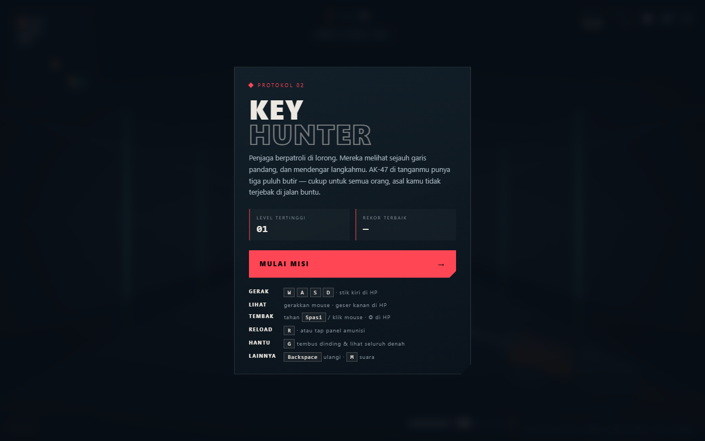
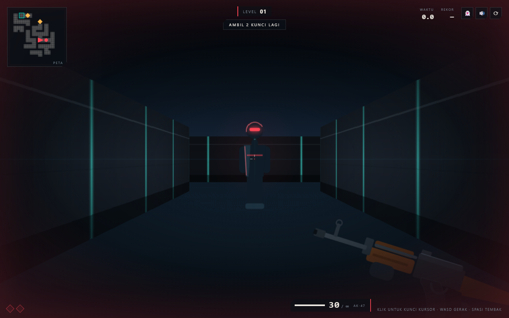
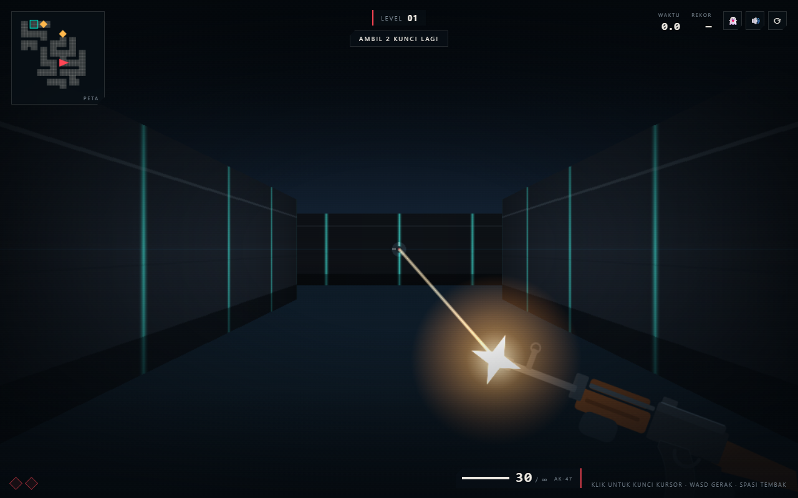
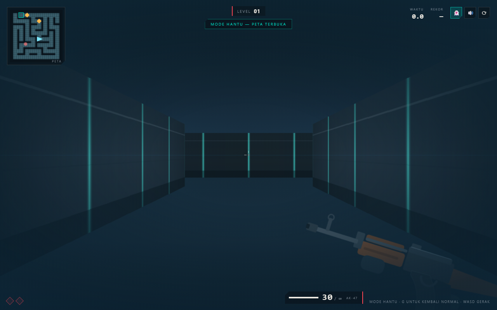

# KEY HUNTER

Game labirin **first-person** di browser. Cahaya cuma menerangi lorong di depanmu, peta di pojok digambar sambil kamu jalan, dan penjaga berpatroli di antara dinding-dinding bertanda neon.

Kumpulkan semua kunci, buka pintu keluar — atau tembak penjaga yang menghalangi. AK-47 di tanganmu punya tiga puluh butir, dan setiap tembakan memancing semua yang ada di sekitar.

Dibuat tanpa engine dan tanpa aset: renderer raycasting sendiri di canvas 2D, sosok penjaga digambar prosedural, suara disintesis pakai WebAudio, labirin digenerate secara acak.






## Cara main

Buka `index.html` langsung di browser (double-click). Tidak perlu server, tidak perlu `npm install`.

Kalau mau lewat server lokal:

```
python -m http.server 8000
```

lalu buka <http://localhost:8000>.

## Kontrol

| Aksi | Desktop | HP |
| --- | --- | --- |
| Gerak | `W` `A` `S` `D` | stik kiri |
| Lihat sekeliling | gerakkan mouse | geser sisi kanan layar |
| Tembak | tahan `Spasi` atau klik kiri (otomatis) | tahan tombol ◎ |
| Reload | `R` | tap panel amunisi |
| Putar badan | `←` `→` | — |
| Mode hantu | `G` | tombol 👻 |
| Kunci kursur | klik layar | — |
| Ulangi level | `Backspace` | tombol ⟳ |
| Suara | `M` | tombol 🔊 |

## Aturan

- Tiap level punya labirin lebih besar, kunci lebih banyak (maks 6), dan penjaga lebih banyak (maks 5).
- Pintu keluar terkunci sampai semua kunci diambil.
- **Penjaga** melihat sejauh garis pandang (7–9 langkah, sudut ~130°) dan mendengar langkahmu dalam radius ~5. Mereka berpatroli acak, menyelidiki suara, lalu mengejar kalau melihatmu.
- Penjaga selalu **lebih lambat** darimu, jadi kamu bisa lari — selama tidak terjebak di jalan buntu.
- **AK-47**: 30 butir per magasin, tembakan otomatis (±600 RPM), reload 2 detik, amunisi cadangan tak terbatas. Tiga peluru menjatuhkan satu penjaga. Senjatanya terlihat di pojok layar: ada recoil, kilatan moncong, jejak peluru ke titik bidik, dan lubang bekas tembakan di dinding.
- Tembakan terdengar sampai radius 16 — semua penjaga di sekitar langsung menuju posisimu. Jadi menembak itu pilihan, bukan solusi.
- Tertangkap = level diulang (layout sama, jadi kamu bisa belajar rute mereka).
- Rekor waktu per level dan level tertinggi disimpan di `localStorage`.

### Mode hantu

Tekan `G` (atau tombol 👻) untuk masuk mode latihan:

- **Tembus dinding** — jalan menembus apa pun, termasuk keluar dari labirin.
- **Penjaga buta** — mereka tidak bisa melihat atau mendengarmu, jadi tidak ada pengejaran dan tidak bisa tertangkap.
- **Peta terbuka** — seluruh denah langsung terlihat di minimap.
- **Waktu berhenti** — timer dibekukan selama mode hantu aktif, lalu lanjut lagi saat dimatikan.
- Layar diberi warna kebiruan supaya jelas kamu sedang di mode lain.

Anggap ini mode latihan: pakai untuk menghafal rute, lalu main normal untuk mencatat waktu.

## Struktur

```
index.html          markup + HUD
css/style.css       tema gelap bersudut ala tactical shooter
js/maze.js          generasi labirin, grid blok, BFS, garis pandang, sinar dinding
js/sentinel.js      AI penjaga (patroli / waspada / mengejar)
js/raycast.js       renderer first-person + sprite penjaga + senapan
js/audio.js         efek suara sintetis
js/game.js          state, input, senjata, aturan main, minimap, HUD
test/maze.test.js   tes properti labirin + navigasi + garis pandang (Node)
```

## Cara kerjanya

**Labirin.** `js/maze.js` memakai recursive backtracker dengan seed (`mulberry32`), lalu membuka sebagian jalan buntu (*braiding*) supaya ada loop. Titik keluar dipilih dari sel terjauh hasil BFS, kunci disebar dengan jarak minimum.

**Lorong lebar.** Labirin sel diubah jadi grid blok dengan langkah `open + 1`. Dengan `open = 2`, tiap sel jadi ruang 2x2 blok dengan dinding satu blok di antaranya — hasilnya lorong selebar dua blok, bukan pipa sempit. Renderer, collision, dan AI semuanya bekerja di grid blok yang sama.

**Renderer.** DDA raycaster: tiap kolom layar satu berkas sinar, tinggi dinding dihitung dari jarak tegak lurus. Tanpa WebGL dan tanpa tekstur — kedalaman dibangun dari peredupan jarak, gradasi vertikal, garis trim, dan seam neon di tepi panel.

**Penjaga.** Sosok manusia digambar prosedural ke kanvas kecil (96x180) lalu diperbesar saat dirender, dengan z-buffer per kolom supaya bisa tertutup dinding sebagian. Siluetnya gelap dengan rim light, visor menyala, dan rompi beraksen. Siklus jalan 4 frame dari posisi kaki dan lengan, jadi mereka terlihat melangkah, bukan meluncur.

**AK-47.** Viewmodel 2D digambar di ruang layar setelah scene 3D, dari muzzle brake, front sight, laras, gas block, handguard kayu, receiver, magasin melengkung, grip, sampai stok kayu. Ada recoil, sway mengikuti langkah, animasi turun saat reload, kilatan moncong berbentuk bintang dengan halo, dan garis jejak peluru dari moncong ke titik bidik. Lubang bekas tembakan disimpan di koordinat dunia, jadi ikut bergeser saat kamu berjalan.

**AI.** Tiga keadaan dengan transisi berbasis persepsi:

- `patrol` — jalan acak antar blok, tidak langsung balik arah.
- `alert` — mendengar langkah atau tembakan, menuju lokasi suara (posisinya diberi jitter, jadi tidak presisi), menyerah setelah ~6 detik.
- `chase` — punya garis pandang, mengejar cepat; kehilangan jejak setelah ~2 detik tanpa pandangan.

Navigasi memakai BFS di grid blok (`nextBlockToward`): hitung jarak dari tujuan, lalu ambil tetangga dengan jarak terkecil. Deterministik dan murah karena gridnya kecil.

**Senjata.** Hitscan: tembak = satu sinar di grid blok (`rayWallDistance`) untuk tahu di mana dinding terdekat, lalu semua penjaga yang jaraknya lebih dekat dari dinding itu, berada dalam toleransi sudut kecil, dan punya garis pandang akan kena. Jadi tidak bisa menembus dinding, dan tidak bisa menembak lawan yang tidak benar-benar di depan crosshair.

**Peta.** Minimap menggambar **denah labirin sebenarnya**, bukan kotak per sel: yang digambar adalah grid blok yang dipakai renderer, jadi lorong selebar dua blok terlihat menyambung dengan dinding di antaranya. Hanya blok yang sudah pernah terlihat yang muncul, dan hasilnya di-cache di kanvas terpisah lalu ditempel ulang tiap frame.

## Pengembangan

Dua URL param untuk mempermudah kerja:

- `?shot=1` — mulai level 1 di persimpangan; `?shot=2` — sama, plus satu penjaga tepat di depan; `?shot=3` — sedang menembak (kilatan + jejak peluru ditahan); `?shot=4` — mode hantu dengan denah penuh. Berguna untuk screenshot.
- `?debug=1` — membuka `window.__KEYHUNTER` (state, `update`, `render`, `fire`, `blocked`, `cellToWorld`) untuk simulasi otomatis.

Jalankan tes:

```
node test/maze.test.js
```

Yang diperiksa: 150 labirin acak (keterhubungan, simetri dinding, pintu keluar, penempatan kunci, determinisme seed), grid blok untuk lebar lorong 1 dan 2 (dinding luar rapat, semua ruang terhubung), navigasi BFS penjaga (setiap langkah benar-benar menuju tujuan), serta konsistensi garis pandang dengan jarak dinding.

## Ide lanjutan

- Penjaga yang berhenti dan memutar pandangan di persimpangan (bukan cuma jalan terus).
- Alarm: kalau satu penjaga melihatmu, yang lain ikut tahu posisimu.
- Senjata kedua dengan peluru lebih sedikit tapi sekali tembak mati.
- Leaderboard harian dengan seed sama untuk semua orang.
